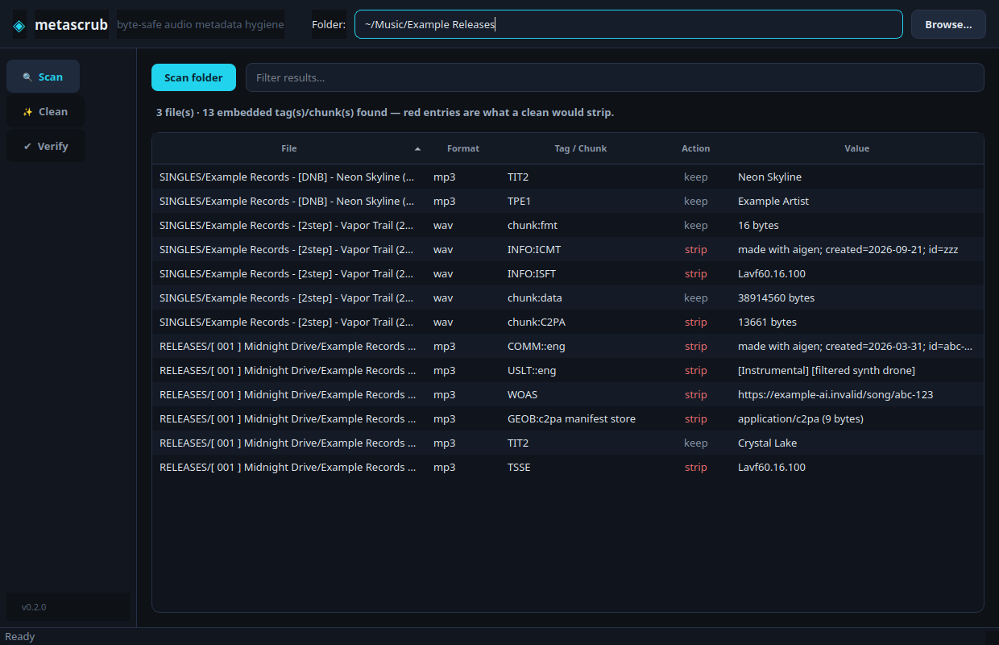
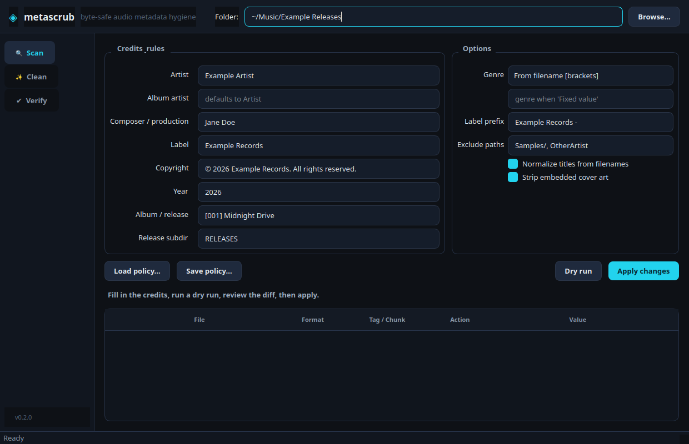

# metascrub

**Byte-safe audio metadata hygiene.** Inspect what a folder of audio files is
really carrying, strip provenance and junk metadata (comments, lyrics, origin
URLs, C2PA manifests, encoder fingerprints, cover art), apply clean uniform
credits, and normalize titles — **without ever re-encoding your audio.**

metascrub is dry-run by default, atomic when it writes, and verifies the audio
payload is byte-identical after every rewrite.

## Why

Audio files picked up from generators, converters and DAW exports carry more
than you think: generator comments and track URLs, unsynced lyric dumps,
C2PA content-provenance manifests, container-origin markers, encoder strings,
embedded thumbnails. General tag editors ignore half of it — especially the
`C2PA` chunk that now ships inside **WAV** files.

metascrub is built around a simple loop:

```
scan  →  see everything that's embedded, with predicted actions
clean →  strip provenance, set credits, normalize titles (dry-run first)
verify → prove nothing revealing remains (exit 1 if it does — CI-friendly)
```

## Install

### Installers (no Python needed)

Grab the package for your platform from
[Releases](https://github.com/VanguardArts/metascrub/releases):

| Platform | Package | Contains |
|----------|---------|----------|
| Windows  | `metascrub-setup-windows.exe` — Inno Setup wizard | GUI + CLI |
| macOS    | `metascrub-gui-macos.dmg` — drag to Applications | GUI app |
| Linux    | `metascrub_<version>_amd64.deb` — `sudo dpkg -i …` | GUI + CLI |
| Linux    | `metascrub-gui-linux.AppImage` — portable, any distro | GUI |

Portable CLI-only archives (`metascrub-cli-{linux,macos}.tar.gz`,
`metascrub-cli-windows.zip`) are attached to the release as well.

The packages are unsigned, so Windows SmartScreen and macOS Gatekeeper will
warn on first run. On Windows choose **More info → Run anyway**; on macOS
right-click the app → **Open** (or run
`xattr -d com.apple.quarantine metascrub-gui.app`).

### From source (pip)

```bash
pip install .          # or: pipx install .
pip install .[gui]     # with the desktop GUI (PySide6)
```

Requires Python ≥ 3.9 and [mutagen](https://mutagen.readthedocs.io/).
YAML policies additionally need `pip install .[yaml]`.

## Quickstart

```bash
# 1. See what's inside
metascrub scan ~/Music/releases

# 2. Preview a cleanup (no files touched)
metascrub clean ~/Music/releases \
  --artist "Example Artist" \
  --composer "Jane Doe" \
  --label "Example Records" \
  --copyright "© 2026 Example Records. All rights reserved." \
  --year 2026 \
  --album "[001] Midnight Drive" --release-subdir RELEASES \
  --label-prefix "Example Records - "

# 3. Apply
metascrub clean ~/Music/releases --policy policy.yaml --apply

# 4. Verify (exit code 0 = clean, 1 = traces remain)
metascrub verify ~/Music/releases
```

`--release-subdir RELEASES` applies the album tag only to files under
`RELEASES/` — singles get no album tag. `--exclude 'Samples/'` skips paths by
regex (repeatable), e.g. sample/stem assets or another artist's archival folder.

## Desktop GUI

A dark-themed desktop app wraps the same engine:

```bash
pip install .[gui]
metascrub-gui          # or: python -m metascrub.gui
```



* **Scan** — every embedded tag/chunk in a color-coded table (red = would be
  stripped, yellow = matches an extra signature), with a live filter, and a
  one-click **Auto-clean** once results are in.
* **Clean** — credits/rules form, policy load/save, dry-run diff, then Apply
  behind a confirmation dialog. Work runs on a background thread with a
  progress bar.



* **Verify** — one-click provenance check with a big pass/fail badge.

## What gets stripped (defaults, all configurable)

| Evidence                              | MP3 (ID3v2.4)                          | WAV (RIFF)        |
|---------------------------------------|----------------------------------------|-------------------|
| comments ("made with ...", ids)       | `COMM`, `TXXX`                         | `INFO:ICMT`       |
| lyrics                                | `USLT`, `SYLT`                         | —                 |
| origin/source URLs                    | `WOAS`, `WXXX`                         | —                 |
| content-provenance manifest           | `GEOB` (c2pa)                          | `C2PA` chunk      |
| container-origin markers              | `TXXX:major_brand` etc.                | —                 |
| encoder fingerprint (`Lavf...`)       | `TSSE`, `TENC`                         | `INFO:ISFT`       |
| private/watermark frames              | `PRIV`                                 | —                 |
| embedded cover art                    | `APIC` (`--keep-cover-art` to keep)    | —                 |

## Credits mapping

| Credit            | MP3 (ID3v2.4)        | WAV (RIFF INFO) |
|-------------------|----------------------|-----------------|
| Artist            | `TPE1` (+`TPE2`)     | `IART`          |
| Album / Release   | `TALB` (release dirs only) | `IPRD`    |
| Year              | `TDRC`               | `ICRD`          |
| Genre (per track) | `TCON`               | `IGNR`          |
| Composer / Production | `TCOM`           | `IENG`          |
| Label / Publisher | `TPUB`               | *(no field)*    |
| Copyright         | `TCOP`               | `ICOP`          |
| Title             | `TIT2`               | `INAM`          |

## Title rules

Titles are derived from **filenames** (embedded titles are often stale or
service-polluted). Given `Example Records - [DNB] - Monochrome [NextGen Edition]
(2026) v2.wav`, the default rules produce `Monochrome [NextGen Edition] v2`:

1. strip the extension;
2. strip the label prefix (`--label-prefix "Example Records - "`);
3. strip the first `[Genre] - ` bracket;
4. strip bare genre prefixes (`titles.strip_genre_prefixes`, e.g. `"DnB - "`);
5. strip any `(YYYY)` year; collapse whitespace.

Edition/version markers (`[Original Edition]`, `v1`, `[Rework]`...) survive,
because they distinguish distinct releases. Disable with `--no-titles`.

## Policy files

Put everything in one YAML/JSON file and reuse it:

```yaml
credits:
  artist: Example Artist
  composer: Jane Doe
  label: Example Records
  copyright: "© 2026 Example Records. All rights reserved."
  year: "2026"
  album: "[001] Midnight Drive"
  release_subdir: RELEASES
titles:
  strip_label_prefix: "Example Records - "
genre_mode: brackets          # per-track genre from the [Genre] in the filename
remove_cover_art: true
remove_unset_credits: true   # evict credit tags even when no replacement is set,
                             # so stale/revealing credits can never survive a clean
exclude: ['Samples/', 'OtherArtist']
extra_signatures: ['mygeneratorusername']
```

CLI flags override policy values. See [examples/policy.example.yaml](examples/policy.example.yaml).

Values matching an `extra_signatures` entry are shown **yellow** ("flag") in
scan results: the clean keeps them (only strips provenance), but Verify hunts
them, so you can hunt down leftovers like an old username yourself. Combined
with `remove_unset_credits`, signature hits in credit fields disappear
entirely instead of being flagged.

## WAV specifics

* Parses the RIFF chunk list directly — handles `LIST`/`INFO` **and** the
  `C2PA` provenance chunk most tools miss.
* `fmt `, `data` and unknown chunks are copied **byte-for-byte**; audio is
  never transcoded.
* Writes are atomic (`*.metascrub.tmp` → rename), and after every write the
  audio chunks are re-hashed and compared to the original. On any mismatch the
  original file is left untouched.
* RIFF INFO has no `label`/`composer` field — the production credit goes to
  `IENG` and the label lives in the MP3 sidecar.

## Exit codes

| Code | Meaning |
|------|---------|
| 0    | success (verify: clean) |
| 1    | verify found provenance signatures |
| 2    | error (bad policy, file errors during clean) |

## Roadmap

- [x] Desktop GUI (PySide6, 8 dark themes incl. slate/anthracite)
- [x] First-launch tutorial wizard (reopenable from the sidebar)
- [x] One-click Auto-clean from scan results (with auto re-scan)
- [ ] FLAC / Ogg / M4A adapters (Vorbis comments, MP4 atoms)
- [ ] Cover-art replace (not just strip)
- [ ] MusicBrainz lookup for real credits
- [ ] Watch-folder mode

## A note on responsible use

metascrub is a metadata hygiene/privacy tool: it removes personal info, service
fingerprints and junk from files you own, and applies your own credits. Be aware
that some distributors and jurisdictions increasingly require disclosure of
AI-generated content, and removing provenance metadata does not by itself change
the copyright status of a work. You are responsible for how you use it.

## License

MIT © 2026 metascrub contributors.
